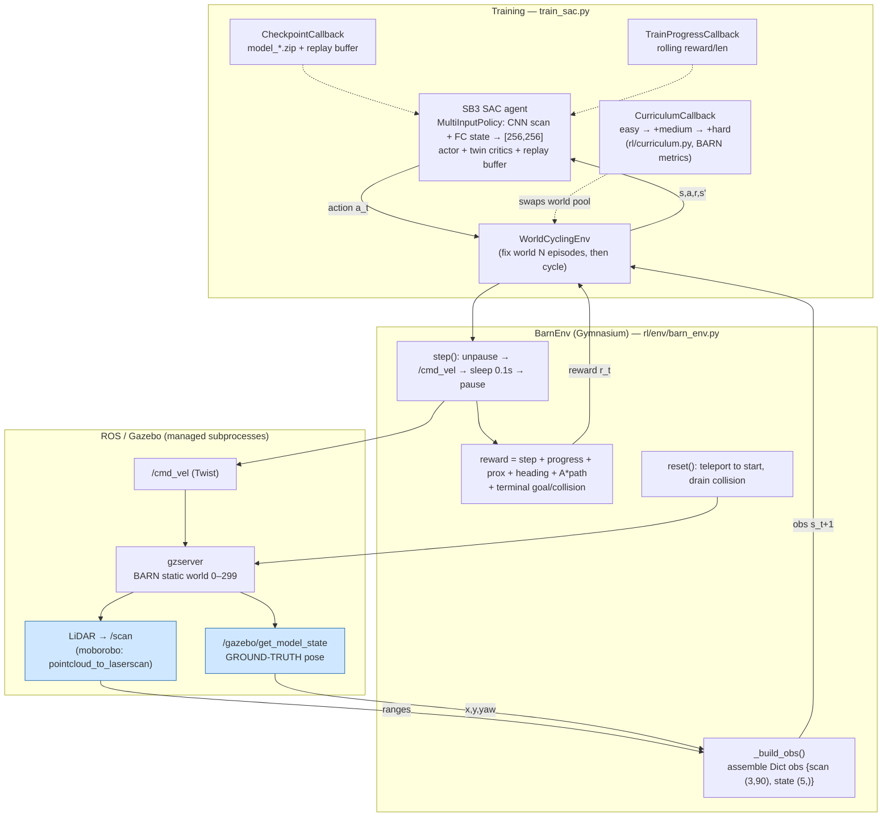
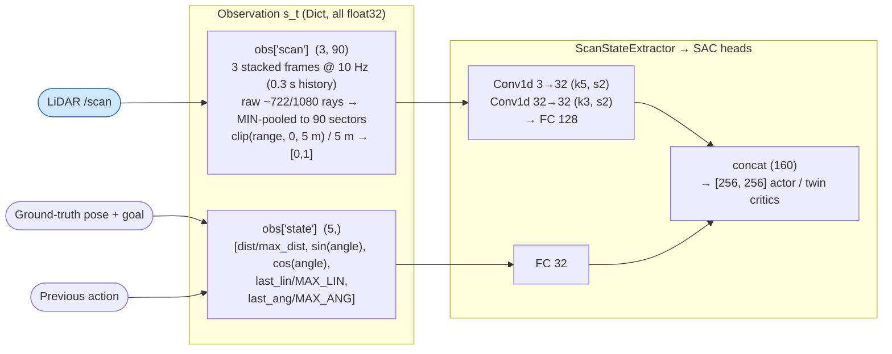
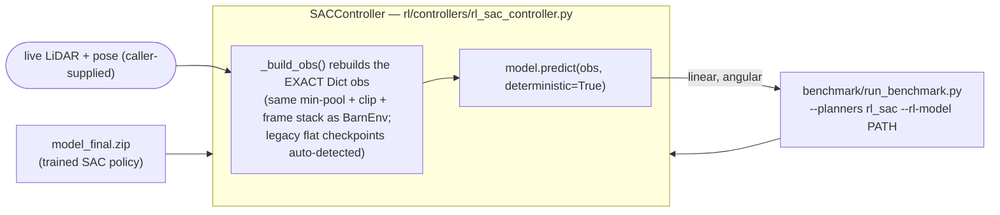

# RL Infrastructure — Architecture Diagram

BARN navigation with **SAC** (Soft Actor-Critic, model-free off-policy RL).
Continuous state → continuous action. **LiDAR is the primary sensor.** Pose comes
from Gazebo ground-truth (not odometry/AMCL during training).

## At a glance

| Aspect | Choice |
| --- | --- |
| Algorithm | SAC (SB3), `MultiInputPolicy` + two-branch `ScanStateExtractor`, heads `[256, 256]` |
| Paradigm | Model-free, off-policy, continuous control |
| State-based? | Two-part Dict: LiDAR stack → 1D-CNN branch, goal/vel state → FC branch |
| LiDAR used? | **Yes** — 3 stacked frames of 90 min-pooled sectors, clipped at 5 m |
| Observation | `{"scan": (3, 90), "state": (5,)}` (scan stack + goal-relative + last action) |
| Action | 2 continuous: `linear_x ∈ [0, MAX_LIN]`, `angular_z ∈ [±MAX_ANG]` |
| Pose source | Gazebo `/gazebo/get_model_state` (ground truth) |
| Reward | Sparse terminal (+100 / -50) + dense shaping (progress/prox/heading/A*-path) |
| Sim | Gazebo @ 10 Hz policy rate (`STEP_DURATION = 0.1 s`) |

## System architecture

## Observation + network — what the policy actually sees

LSTM DENENECEK CEVRESEL HIZ VS EKLE

Notes that the diagram encodes:
- **Two-part structure** (Fan & Long et al. ICRA'18; DRL-VO T-RO'23): perception and
  goal/velocity state are encoded by separate branches and fused before the heads.
  The conv treats the 3 stacked frames as channels, so kernels see per-sector change
  over time (approach speed) — the policy is otherwise memoryless.
- **Min-pooling, not interpolation:** a thin obstacle hit by one raw ray can never
  vanish from the downsampled scan.
- **5 m clip normalisation:** BARN gaps are < 1 m; normalising by the raw 10 m sensor
  range would squash all decision-relevant geometry into [0, 0.1].
- **The A\* reference path is reward-only** — it shapes the reward (path-deviation penalty)
  but is deliberately **never** in the observation, so the policy must still infer the
  corridor from LiDAR alone.

## Train ≡ deploy contract

`SACController` reproduces `BarnEnv._build_obs()` bit-for-bit so the deployed policy
sees the same input distribution it trained on. At deploy time the **pose source is a
function argument** — the benchmark passes ground-truth, but a real robot would inject
`/odom` or AMCL there instead.
